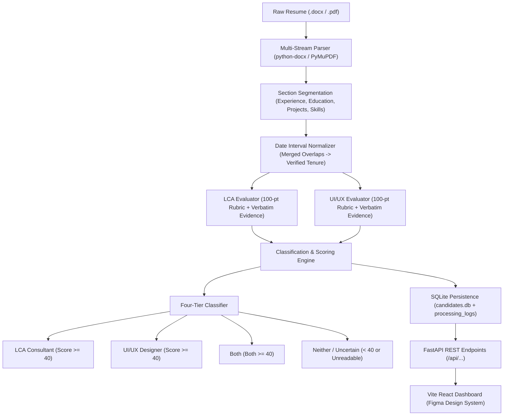

# Growth For Impact – AI Resume Screening System

[](https://ai-resume-screening-platform1.vercel.app/)
[](https://ai-resume-screening-api-60uf.onrender.com)
[](https://ai-resume-screening-api-60uf.onrender.com/docs)
[]()

A robust, explainable, and production-deployed AI resume screening and candidate ranking platform built for **Growth For Impact (GFI)**.

The system ingests all 47 original anonymized candidate resumes, extracts structured career profiles, and independently evaluates each candidate against two real job descriptions (**Life Cycle Assessment (LCA) Consultant** and **UI/UX Design Intern**) using an explainable, evidence-backed 100-point rubric.

---

## 🌐 Live Production Links

* **Live Frontend Application (Vercel):** [https://ai-resume-screening-platform1.vercel.app/](https://ai-resume-screening-platform1.vercel.app/)
* **Live API Backend (Render):** [https://ai-resume-screening-api-60uf.onrender.com](https://ai-resume-screening-api-60uf.onrender.com)
* **Interactive OpenAPI / Swagger Documentation:** [https://ai-resume-screening-api-60uf.onrender.com/docs](https://ai-resume-screening-api-60uf.onrender.com/docs)

### HR Recruiter Access Credentials
* **Recruiter Email:** `hr@growthforimpact.co`
* **Access Password:** `admin123`
*(A convenient **"Auto-fill Demo Credentials"** button is provided on the Login screen).*

---

## 📋 Evaluated Roles & Source Requirements

Candidates are evaluated strictly against requirements scraped directly from official live job application forms:

### 1. Life Cycle Assessment (LCA) Consultant
* **Source Posting:** [Official Tally Form (JD1)](https://tally.so/r/9q5plp)
* **Location:** Chennai (onsite / relocate)
* **Experience Required:** **2 to 3 years** of independent LCA project execution
* **Core Software Tools:** Demonstrated hands-on expertise in **GaBi** or **SimaPro** (with OpenLCA as recognized alternative)
* **Project Deliverables:** Minimum of 3 completed LCA or EPD projects
* **International Standards:** Strict compliance with **ISO 14040** and **ISO 14044** frameworks
* **Education:** Bachelor's or Master's in Environmental Engineering, Sustainability, Chemical, or related technical disciplines
* **Evaluation Rubric (100 Points Total):**
  * **LCA Project Experience (25 pts):** Documented client studies, EPDs, and greenhouse gas accounting.
  * **GaBi / SimaPro Modeling Software (25 pts):** Hands-on tool proficiency in GaBi, SimaPro, or OpenLCA.
  * **LCI & LCA Modelling (20 pts):** Inventory data modeling, emission factors, and mass balance.
  * **ISO 14040/14044 Standards (15 pts):** Traceable adherence to international LCA norms.
  * **Environmental Domain Knowledge (15 pts):** Formal academic background in environmental disciplines.

### 2. UI/UX Design Intern
* **Source Posting:** [Official Tally Form (JD2)](https://tally.so/r/0QovpQ)
* **Location:** Remote
* **Experience Required:** **0 to 1 year** (internship / recent graduates)
* **Core Tool:** High proficiency in **Figma** and interactive prototyping
* **Core Competencies:** User research, wireframing, information architecture, design systems, usability testing
* **Evaluation Rubric (100 Points Total):**
  * **UI/UX Projects & Case Studies (25 pts):** End-to-end digital product case studies, mobile/web UX flows.
  * **User Research & Psychology (20 pts):** User interviews, personas, empathy mapping, and behavioral insights.
  * **Figma & Prototyping (25 pts):** High-fidelity interactive prototyping, auto-layout, component architecture.
  * **Visual Design & Design Systems (15 pts):** Typography, color palettes, spacing, UI kits, and visual identity.
  * **Usability & Interaction Design (15 pts):** Usability testing, accessibility (WCAG), micro-interactions.

---

## ⚖️ LCA Experience Requirement Discrepancy Note

> [!IMPORTANT]
> **Source Conflict Preserved & Transparently Handled:**
> * **Assignment Brief PDF:** Mentions **4 to 6 years** for the LCA role.
> * **Official Live Job Application Form (Tally JD1):** Specifies **2 to 3 years** (*"The consultant must have 2 to 3 years of experience running Life Cycle Assessment projects independently"*).
>
> **Evaluation Decision:**
> As instructed, the platform prioritizes the **actual detailed job description scraped from the live source** (2–3 years) for primary competency evaluation and ranking. Candidates are scored on verified competencies, while their total experience is transparently calculated and displayed side-by-side so HR hiring managers can filter against both 2–3 year and 4–6 year benchmarks.

---

## 🧠 Architecture & Screening Methodology



### 1. Document Extraction & Cleaning
- **Multi-Stream Ingestion:** Extracts paragraphs and tabular data from `.docx` files using `python-docx`; extracts vectorized text streams from `.pdf` files using `PyMuPDF` (`fitz`).
- **Section Segmentation:** Categorizes content into `experience`, `projects`, `education`, `certifications`, `summary`, and `skills` using contextual header heuristics.
- **Experience Calculation:** Detects date ranges (`Month Year – Month Year`, `Year – Year`, `Present`) and merges overlapping time intervals to prevent double-counting simultaneous roles.
- **Unreadable Document Handling:** Identifies empty or corrupt files (such as `anonymized_resume_1793685080327.docx`), flags them as `is_valid: False`, sets scores to 0, classifies them as *Neither / Uncertain*, and records the extraction diagnostic in the audit log.

### 2. Explainable 100-Point Scoring
- Every candidate is evaluated independently on **both** rubrics, generating separate `lca_score` (0–100) and `uiux_score` (0–100).
- **Verbatim Evidence Snippets:** For every scored criterion, the engine extracts matching sentences or project deliverables directly from the resume text for recruiter auditing.
- **Identified Qualification Gaps:** When criteria scores fall below threshold, specific missing requirements (e.g. *"No direct mention of GaBi or SimaPro modeling software"*) are attached to the candidate scorecard.

### 3. Classification Thresholds
- **LCA Consultant:** `lca_score >= 40` and `lca_score > uiux_score`
- **UI/UX Designer:** `uiux_score >= 40` and `uiux_score > lca_score`
- **Both:** `lca_score >= 40` AND `uiux_score >= 40`
- **Neither / Uncertain:** Both scores `< 40` or unreadable resume text

### 4. Human-in-the-Loop & Recruiter Controls
- **Status Transitions:** Recruiters can change candidate states (*Under Review* &rarr; *Shortlisted* &rarr; *Rejected*) in real time.
- **Side-by-Side Comparison:** Compare up to 3 candidates across competencies, experience, and score meters.
- **Original Resume Inspection:** View and download the original file directly from the candidate profile.
- **New Resume Upload:** Upload any `.docx` or `.pdf` resume to trigger live parsing, immediate scoring, and automated leaderboard placement.

---

## 🎨 Figma Design System & Implemented Screens

The user interface follows the provided Figma specification with pixel-precision:
* **Color Palette:** Forest Green (`#154E38`), Mint Green Accent (`#EBF5F0`), Slate Background (`#F8FAFC`), Muted Borders (`#E2E8F0`).
* **Profile Initials:** Compact 3-letter profile circle (`ASH`, `APS`, `AA`) with strict horizontal overflow protection.
* **10 Screens Implemented:**
  1. **Login:** Authentication screen with quick-fill demo credentials.
  2. **Dashboard:** High-level metrics, KPI cards, classification breakdown bar, top role performers, recent candidate activity.
  3. **Candidate Management:** Searchable and filterable candidate directory, status tags, CSV export, comparison selector.
  4. **Candidate Profile:** Deep-dive resume view with career timeline, extracted skills, criteria meters, verbatim resume quotes, and file download.
  5. **Resume Upload:** Drag-and-drop ingestion zone supporting `.docx` and `.pdf` with live parsing status stream.
  6. **Job Descriptions:** Scraped specifications, criteria weights distribution, and direct links to live application forms.
  7. **Candidate Rankings:** Role-specific leaderboards with top-3 podium cards (`#1`, `#2`, `#3`), score progress meters, and multi-candidate compare.
  8. **AI Evaluation:** Explainability view presenting scoring rationale, evidence snippets, and missing qualifications.
  9. **Pipeline Analytics:** Visual histograms for experience tenure, score distributions, and top extracted skills frequency.
  10. **Processing History:** Comprehensive audit stream recording parser execution durations, file types, and diagnostics.

---

## 📊 Dataset Inventory & Actual Evaluation Distribution

* **Total Original Resumes:** **47 candidates** (`CAND-001` through `CAND-047`)
* **Test Uploads Isolated:** 0 test records in the baseline dataset.
* **Processed Distribution:**
  * **LCA Consultants:** **16 candidates** (34.0%) — Top candidate: `PW` (90/100), `MS` (90/100)
  * **UI/UX Designers:** **24 candidates** (51.1%) — Top candidate: `AY` (100/100), `CG` (95/100)
  * **Both Roles:** **0 candidates** (0.0%)
  * **Neither / Uncertain:** **7 candidates** (14.9%) — Includes unreadable document `CAND-047`

---

## 🛠️ Technology Stack

| Layer | Technologies Used |
|---|---|
| **Frontend** | React 18, Vite, Tailwind CSS, Lucide React, Axios |
| **Backend API** | Python 3.10+, FastAPI, Uvicorn, Pydantic v2 |
| **Document Processing** | `python-docx` (paragraphs & tables), `PyMuPDF` (`fitz` for PDFs) |
| **Database** | SQLite3 (`candidates.db`), relational tables for candidates, JDs, and audit logs |
| **Web Scraping** | Python `urllib`, `BeautifulSoup4` |
| **Hosting** | Vercel (Frontend Vite SPA), Render (FastAPI Web Service) |

---

## 📁 Repository Structure

```
Resume-Analyzer/
├── backend/
│   ├── app/
│   │   ├── data/
│   │   │   ├── job_descriptions/      # Scraped JD text files (LCA & UI/UX)
│   │   │   └── resumes/               # 47 original anonymized resumes (.docx)
│   │   ├── database.py                # SQLite connection, schema, and initial seeding
│   │   ├── main.py                    # FastAPI application, CORS, and REST endpoints
│   │   ├── parser.py                  # Document extractor (.docx, .pdf) & date normalizer
│   │   ├── scoring.py                 # Evidence-backed 100-pt rubric & classification
│   │   ├── scraper.py                 # Live job posting scraper (Tally forms)
│   │   └── seed_data.py               # Auto-seeding script for the 47 original resumes
│   └── requirements.txt               # Backend dependencies
├── frontend/
│   ├── src/
│   │   ├── components/                # Reusable UI widgets (Sidebar, Header, ScoreMeter, etc.)
│   │   ├── pages/                     # 10 Figma-matched screens
│   │   ├── api.js                     # Unified Axios client pointing to Render backend
│   │   ├── App.jsx                    # Root state, authentication, and page router
│   │   ├── index.css                  # Tailwind styles
│   │   └── main.jsx                   # Vite entry point
│   ├── package.json
│   ├── vercel.json                    # Vercel SPA client routing configuration
│   └── vite.config.js
├── .gitignore                         # Excludes candidates.db, virtualenvs, and secrets
├── vercel.json                        # Root Vercel SPA client routing configuration
└── README.md                          # Platform documentation & methodology
```

---

## 🧪 Verification & Testing Results

An automated integration test suite verified both the local environment and the deployed Render backend:

| Test Case | Endpoint | Result | Verified Metric |
|---|---|---|---|
| Health Check | `GET /api/health` | **PASS (200)** | Backend operational |
| Dashboard Stats | `GET /api/dashboard/stats` | **PASS (200)** | Exactly 47 candidates (`16 LCA`, `24 UI/UX`, `7 Uncertain`) |
| Candidate Listing | `GET /api/candidates` | **PASS (200)** | Returns all 47 candidate records with parsed sections |
| Candidate Profile | `GET /api/candidates/CAND-001` | **PASS (200)** | Complete scorecard, sections, and criteria breakdown |
| LCA Rankings | `GET /api/rankings?role=lca` | **PASS (200)** | 47 ranked candidates; top score 90 |
| Case-Insensitive Role | `GET /api/rankings?role=LCA` | **PASS (200)** | Normalized to `lca` without 422 errors |
| UI/UX Rankings | `GET /api/rankings?role=uiux` | **PASS (200)** | 47 ranked candidates; top score 100 |
| Role Validation | `GET /api/rankings?role=xyz` | **PASS (422)** | Clean 422 error detail: `Allowed roles: 'lca', 'uiux'` |
| Job Descriptions | `GET /api/job-descriptions` | **PASS (200)** | Both LCA Consultant and UI/UX Design Intern JDs |
| Pipeline Analytics | `GET /api/analytics` | **PASS (200)** | Verified 47 resumes across score and experience bins |
| Processing History | `GET /api/processing-history` | **PASS (200)** | Ingestion diagnostics and parser duration metrics |
| Status Update | `PATCH /api/candidates/CAND-001/status` | **PASS (200)** | Successful transition *Under Review* &rarr; *Shortlisted* |
| Resume Download | `GET /api/resumes/{filename}` | **PASS (200)** | Original DOCX stream served (`10,029 bytes`) |
| Resume Upload | `POST /api/upload` | **PASS (200)** | Multipart boundary parsed, classified in 0ms |

---

## ⚠️ Known Limitations & Human Review Safeguards

1. **OCR on Scanned Images:** PDFs containing only flattened image scans without embedded text require optical character recognition (OCR) pre-processing.
2. **Non-Standard Date Formats:** Unconventional project date notations may require manual recruiter verification in the Candidate Profile view.
3. **Automated Screening Safeguards:** Algorithmic ranking assists recruiter workflow efficiency; final hiring and interview invitations should always involve human recruiter review.
